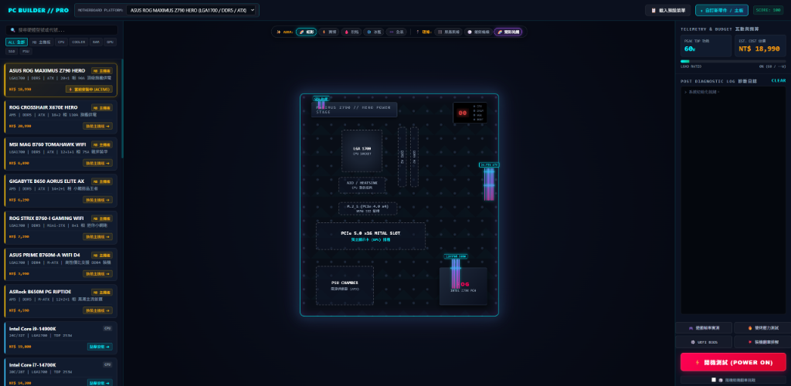
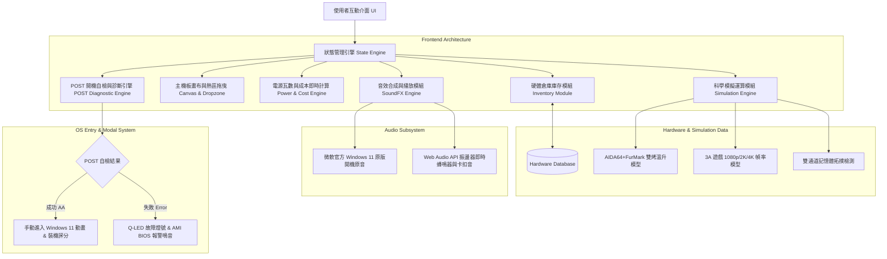

# 專業 PC 組裝評估模擬器 (PC Builder & Feasibility Engine)
> 基於 Vibe Coding 與純原生前端技術打造的硬體相容性評估、動態組裝模擬、BIOS 超頻與真實除錯互動平台。



---

## 1. 系統架構 (System Architecture)

本系統採用純原生前端技術（HTML5 / Vanilla CSS3 / Modern ES6+ JavaScript），實現零外部依賴、輕量化、極速渲染之單頁應用（SPA）。

### 1.1 系統模組架構圖



---

### 1.2 前端分層職責說明

| 架構層級 | 技術實現 | 核心職責 |
| :--- | :--- | :--- |
| **結構層 (DOM)** | 語意化 HTML5 (`index.html`) | 劃分三大核心區域：左側零件庫存倉、中央主機板插槽熱區、右側儀表控制面板。 |
| **樣式層 (Design)** | Vanilla CSS3 / CSS Grid & Flexbox | 採用 Tech-Noir 玻璃擬態風格、自定義 CSS 變數、AURA Sync RGB 燈效與理線材質動態渲染。 |
| **邏輯與狀態層** | 原生 JavaScript (ES6+) | 全局狀態機 `gameState` 集中管控零件安裝、相容性防呆、雙通道拓撲及日誌佇列。 |
| **音效層 (Audio)** | Web Audio API + 官方音訊採樣 | 雙軌架構：微軟官方 Windows 11 原版開機音效（Base64 模組），配合 Web Audio API 即時合成 AMI 蜂鳴器、理線卡扣與散熱撕膜音效。 |
| **科學模擬層** | 物理與數學回歸演算法 | 根據硬體 TDP、解熱能力、IPC 權重即時運算雙烤核心溫度、瓦數負載及 3A 遊戲 FPS。 |

---

## 2. 核心資料模型與規範 (Data Models & Schemas)

### 2.1 硬體資料模型 (Hardware DB Schema)

```typescript
// 主機板規格模型
interface Motherboard {
  id: string;                      // 唯一識別碼 (如 mb_z790)
  name: string;                    // 完整產品型號
  type: "motherboard";
  socket: "LGA1700" | "AM5";       // CPU 腳位防呆相容規範
  ramType: "DDR4" | "DDR5";        // 記憶體世代規範
  formFactor: "ATX" | "M-ATX" | "Mini-ITX";
  chipset: string;                 // Z790, B650, B760 等
  price: number;                   // 零件價格 (NTD)
}

// 零組件資料模型 (CPU / GPU / RAM / Cooler / SSD / PSU)
interface ComponentPart {
  id: string;                      // 唯一識別碼
  name: string;                    // 零件名稱
  type: "cpu" | "cooler" | "ram" | "gpu" | "ssd" | "psu";
  price: number;                   // 價格
  specs: string;                   // 規格簡述標籤
  score: number;                   // 基準效能權重分
  
  // 專屬擴充屬性
  socket?: "LGA1700" | "AM5";      // CPU / Cooler 相容腳位
  tdp?: number;                    // CPU / GPU 功耗瓦數 (W)
  coolingCapacity?: number;        // 散熱器最大解熱能力 (W)
  ramType?: "DDR4" | "DDR5";       // 記憶體規格
  wattage?: number;                // 電源供應器額定瓦數 (W)
}
```

### 2.2 全局運行狀態 (Global Game State)

```javascript
const gameState = {
    selectedMotherboard: 'mb_z790',
    installed: {
        cpu: null,
        cooler: null,
        'ram-1': null,      // DIMM Slot A2 (優先通道)
        'ram-2': null,      // DIMM Slot B2 (次優先通道)
        gpu: null,
        ssd: null,
        psu: null
    },
    cableColor: 'sleeved-white', // 當前選用理線外觀
    rgbMode: 'rainbow'           // AURA Sync 燈光主題
};
```

---

## 3. 核心邏輯與演算法資料 (Core Logic & Algorithms)

### 3.1 POST 開機自檢時序與診斷狀態機
硬體自檢嚴格比照真實主機板 Q-LED 檢測時序：

```
[通電 POWER ON] 
      │
      ▼
1. CPU 檢測 ── (無 CPU / 無散熱器) ──► 🔴 CPU 故障燈 (0x00/0x01) ──► 急促警報連鳴
      │ (通過)
      ▼
2. DRAM 檢測 ── (無記憶體 / 規格不符) ──► 🟡 DRAM 故障燈 (0x55) ──► 3 聲長嗶
      │ (通過)
      ▼
3. VGA 檢測 ── (無獨立顯示卡) ──► ⚪ VGA 故障燈 (0xD6) ──► 1 長 2 短嗶
      │ (通過)
      ▼
4. BOOT 供電 ── (無電供 / 瓦數不足 / 無SSD) ──► 🟢 BOOT 故障燈 (0xEE/0xEF/0xB2) ──► 斷電保護
      │ (通過)
      ▼
[POST PASS] ── 清脆 1x BEEP 短鳴 ── 七段顯示器代碼 AA
      │
      ▼
[手動點擊進入系統] ──► 觸發微軟 Windows 11 官方原版音效 ──► OS 全螢幕載入 ──► 裝機評分報告
```

### 3.2 雙烤壓力測試溫升計算模型 (Stress Model)
依據實際散熱器熱傳導阻抗與環境基準溫（$T_{\text{ambient}} = 26^\circ\text{C}$）計算：

$$T_{\text{CPU}} = 26 + \left(\frac{\text{TDP}_{\text{CPU}}}{\text{CoolingCapacity}_{\text{Cooler}}}\right) \times 72$$

$$T_{\text{GPU}} = 26 + \left(\frac{\text{TDP}_{\text{GPU}}}{450}\right) \times 52$$

- **過熱保護機制**：若 CPU 溫升超過 $100^\circ\text{C}$，即時觸發 PROCHOT 降頻與紅字警告。

### 3.3 3A 遊戲 1080p / 2K / 4K 幀率推導模型 (Gaming Model)

$$\text{FPS}_{\text{Base}} = \left( \text{GPU}_{\text{Score}} \times 0.7 + \text{CPU}_{\text{Score}} \times 0.3 \right) \times \text{ResFactor}$$

- 解析度衰減係數：$\text{ResFactor}_{1080\text{p}} = 1.0$，$\text{ResFactor}_{2\text{K}} = 0.68$，$\text{ResFactor}_{4\text{K}} = 0.42$
- **雙通道增益**：若偵測到雙通道插槽滿載，幀率自動獲得 $+8\%$ 增益，且 1% Low FPS 顯著提升 $+15\%$。

---

## 4. 專案檔案清單與職責 (File Structure)

```text
├── index.html            # 專案主程式 (整合結構、CSS 樣式、核心邏輯與互動畫布)
├── preview.png           # 系統主介面預覽截圖
├── win11_audio.js        # 微軟官方 Windows 11 原版開機音效 Base64 內嵌模組
├── win11_startup.wav     # 微軟官方 Windows 11 原版開機音訊備份檔
├── README.md             # 本系統架構與技術資料規格書
└── .gitignore            # Git 忽略設定檔 (過濾個人作業與備份檔案)
```
